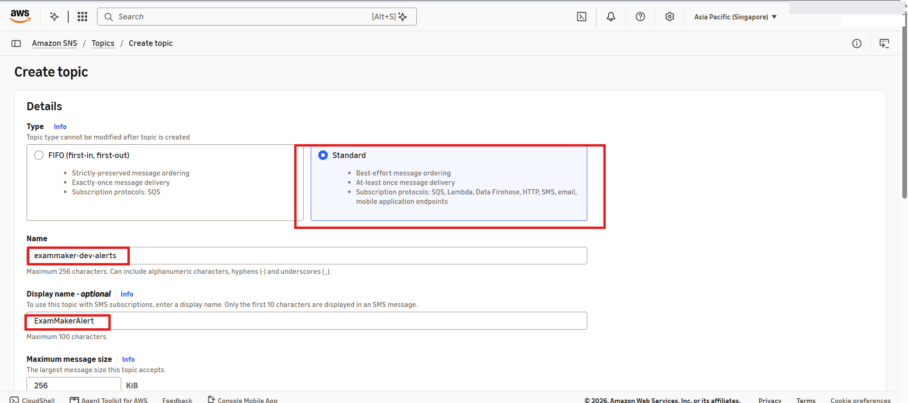
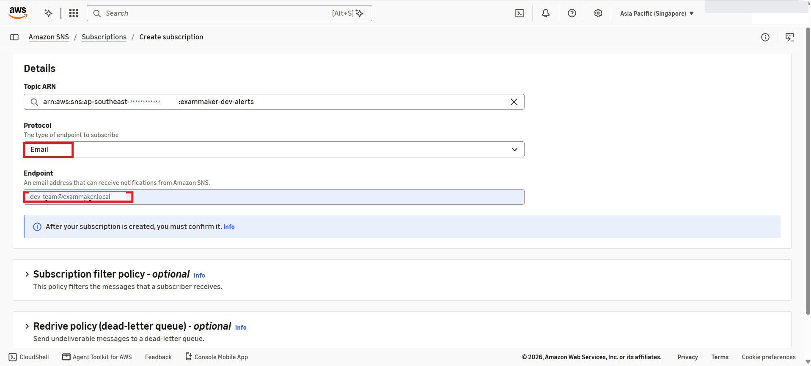

#### Bước 1: Khởi tạo Amazon SNS Topic exammaker-dev-alerts (Hình 13)

1. Mở **Amazon SNS Console** (p-southeast-1) → menu trái chọn **Topics** → bấm **Create topic**.
2. Tại mục **Details**:
   - **Type:** Tích chọn **Standard**.
   - **Name:** Điền **exammaker-dev-alerts**.
   - **Display name - optional:** Điền **ExamMakerAlert**.
3. Bấm **Create topic** ở cuối trang.

---

#### Bước 2: Tạo Email Subscription Nhận Cảnh báo từ Topic (Hình 13.2)

1. Tại trang chi tiết Topic **exammaker-dev-alerts**, bấm nút **Create subscription**.
2. Tại mục **Details**:
   - **Topic ARN:** Giữ nguyên ARN của exammaker-dev-alerts.
   - **Protocol:** Chọn **Email**.
   - **Endpoint:** Nhập địa chỉ email của thành viên đội kỹ thuật.
3. Bấm **Create subscription** và xác nhận liên kết (**Confirm subscription**) trong hộp thư email.

