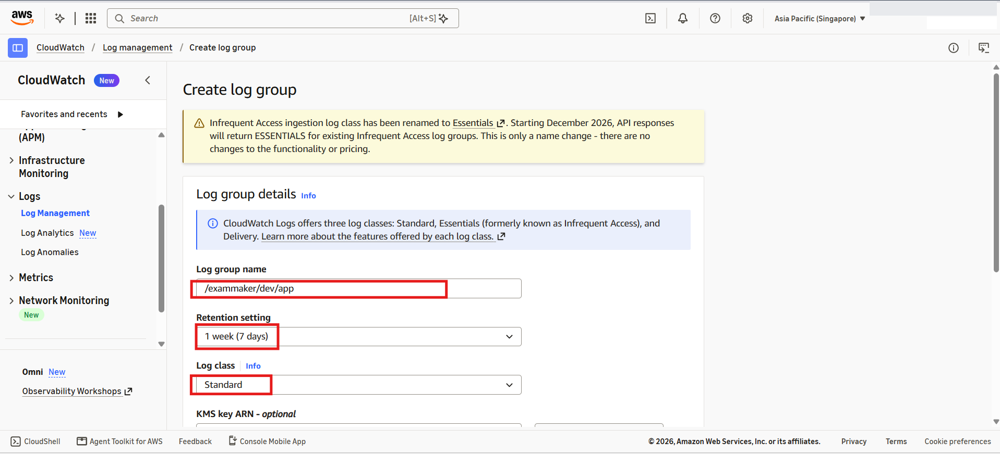
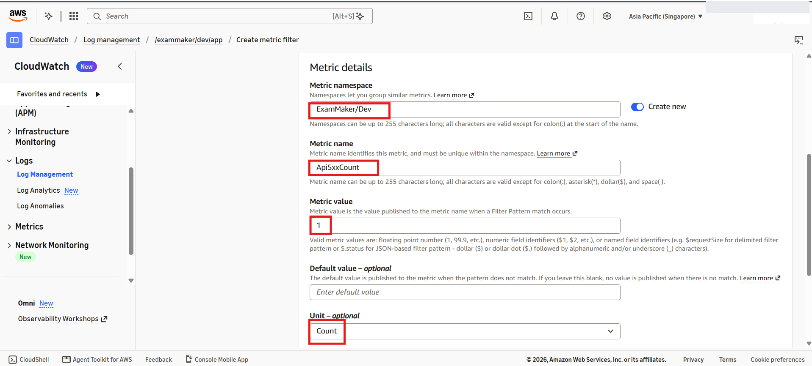

#### Step 1: Create `/exammaker/dev/app` Log Group with 7-Day Retention

1. Open **Amazon CloudWatch → Logs → Log groups → Create log group**.
2. Configure:
  * *Log group name:* `/exammaker/dev/app`
  * *Retention setting:* `1 week (7 days)` _(keeps log storage well under the 5 GB free tier cap)_
  * *Log class:* `Standard`

#### Step 2: Create 4 Metric Filters Under Namespace `ExamMaker/Dev`

Inside `/exammaker/dev/app`, open **Metric filters → Create metric filter** to publish 4 operational metrics into namespace `ExamMaker/Dev` (`Metric value = 1`, `Unit = Count`):

1. `Api5xxCount` (tracks HTTP 5xx server errors from the backend API)
2. `WorkerHeartbeat` (verifies the background AI Worker process is alive)
3. `StuckRunningJobs` (detects jobs stuck in `Running` state)
4. `WorkerErrorCount` (counts unhandled Worker exceptions during Bedrock / RDS calls)

