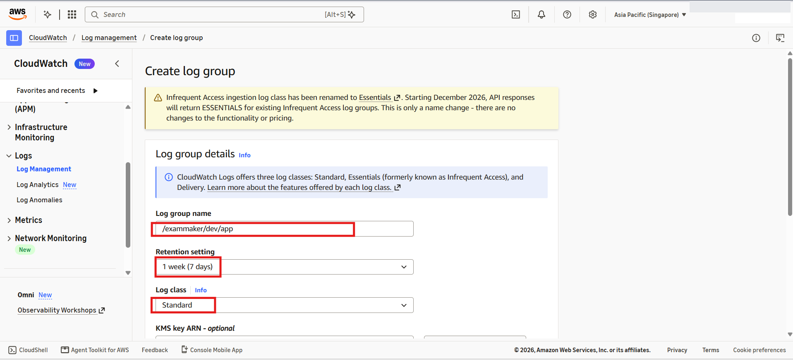
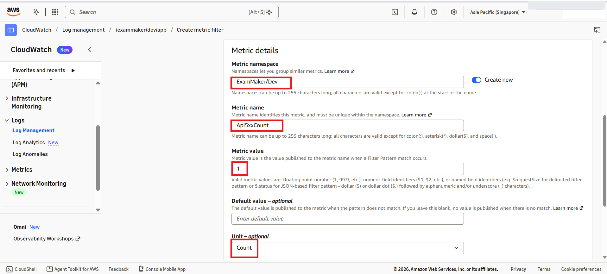

#### Bước 1: Tạo CloudWatch Log Group `/exammaker/dev/app` lưu giữ 7 ngày

1. Mở **Amazon CloudWatch → Logs → Log groups → Create log group**.
2. Cấu hình:
  * *Log group name:* `/exammaker/dev/app`
  * *Retention setting:* `1 week (7 days)` (đảm bảo dung lượng log luôn nằm dưới hạn mức 5 GB miễn phí)
  * *Log class:* `Standard`

#### Bước 2: Tạo 4 Metric Filters vào Namespace `ExamMaker/Dev`

Trong Log Group `/exammaker/dev/app`, chọn tab **Metric filters → Create metric filter** để trích xuất 4 chỉ số vận hành vào namespace `ExamMaker/Dev` (`Metric value = 1`, `Unit = Count`):
1. `Api5xxCount` (đếm lỗi HTTP 5xx từ backend API)
2. `WorkerHeartbeat` (nhịp đập xác nhận tiến trình AI Worker đang hoạt động)
3. `StuckRunningJobs` (phát hiện job bị treo ở trạng thái Running)
4. `WorkerErrorCount` (đếm ngoại lệ trong quá trình Worker gọi Bedrock / RDS)

