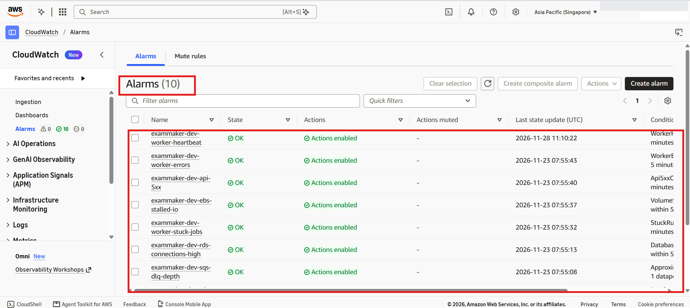

#### Complete Set of 10/10 Standard CloudWatch Alarms (`Period = 300s` — Free Tier $0)

All 10 alarms route notifications to the `exammaker-dev-alerts` SNS Topic and report **100% `OK` status**:

1. `exammaker-dev-worker-heartbeat`: `< 1` over 5 minutes
2. `exammaker-dev-worker-errors`: `>= 3` errors over 5 minutes
3. `exammaker-dev-api-5xx`: `>= 5` HTTP 5xx responses over 5 minutes
4. `exammaker-dev-ebs-stalled-io`: `> 0` stalled I/O events on the root EBS volume
5. `exammaker-dev-worker-stuck-jobs`: `> 0` stuck jobs over 5 minutes
6. `exammaker-dev-rds-connections-high`: `> 50` database connections
7. `exammaker-dev-sqs-dlq-depth`: `> 0` messages in the Dead-Letter Queue
8. `exammaker-dev-sqs-oldest-msg`: oldest message age `> 600s` (10 minutes)
9. `exammaker-dev-ec2-cpu-high`: CPU utilization `> 80%` for 10 minutes (`2 x 5m`)
10. `exammaker-dev-rds-storage-low`: free storage space `< 2 GB` (`2,147,483,648` bytes)

