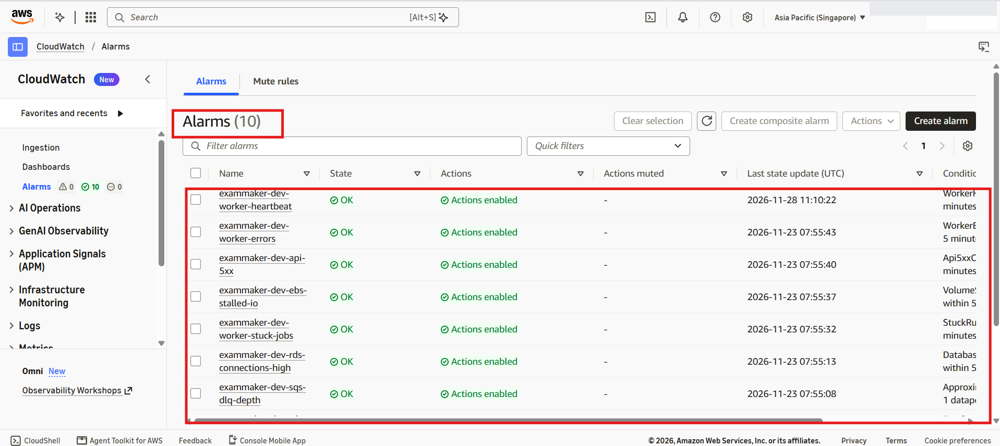

#### Bộ 10/10 Standard CloudWatch Alarms (`Period = 300s` — Free Tier $0)

Tất cả 10 cảnh báo gửi thông báo trực tiếp về SNS Topic `exammaker-dev-alerts` và đều đạt trạng thái `OK` 100%:

1. `exammaker-dev-worker-heartbeat`: `< 1` trong 5 phút
2. `exammaker-dev-worker-errors`: `>= 3` lỗi trong 5 phút
3. `exammaker-dev-api-5xx`: `>= 5` lỗi HTTP 5xx trong 5 phút
4. `exammaker-dev-ebs-stalled-io`: `> 0` trên ổ EBS gốc
5. `exammaker-dev-worker-stuck-jobs`: `> 0` job treo trong 5 phút
6. `exammaker-dev-rds-connections-high`: `> 50` kết nối DB
7. `exammaker-dev-sqs-dlq-depth`: `> 0` message trong DLQ
8. `exammaker-dev-sqs-oldest-msg`: tuổi message `> 600s` (10 phút)
9. `exammaker-dev-ec2-cpu-high`: CPU `> 80%` trong 10 phút (`2 x 5m`)
10. `exammaker-dev-rds-storage-low`: dung lượng trống `< 2 GB` (`2,147,483,648` bytes)

