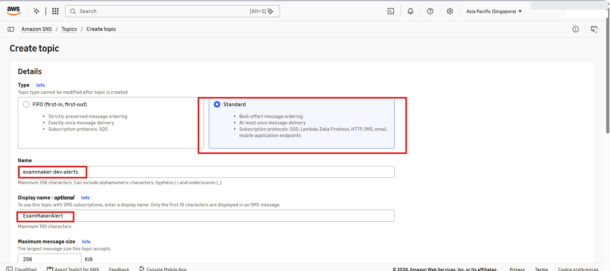
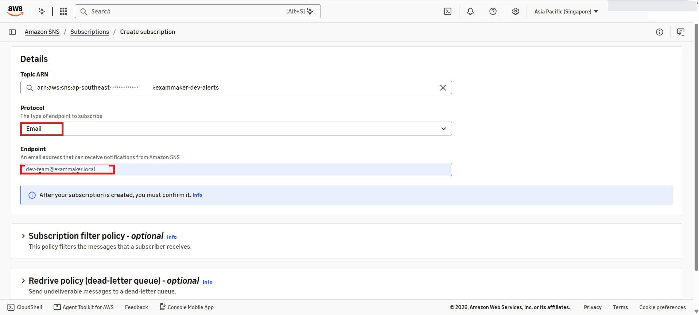
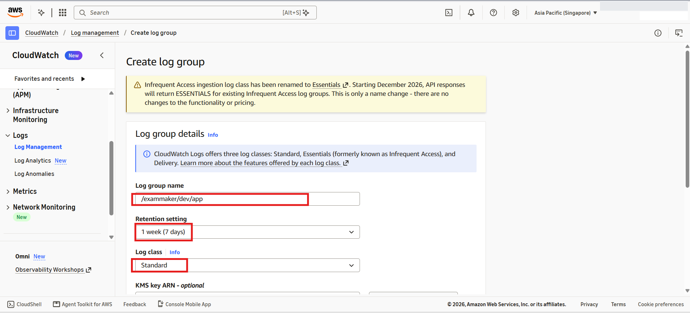
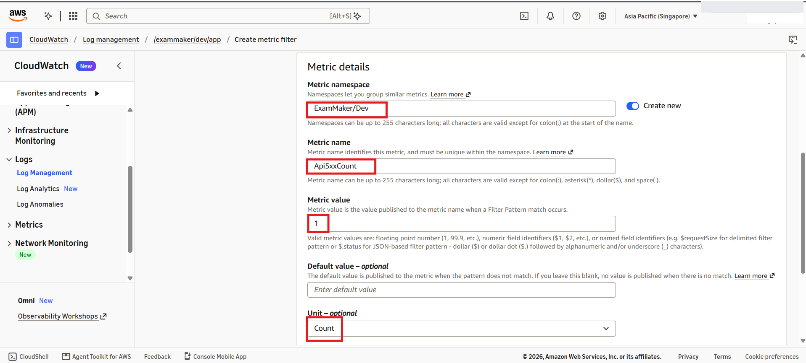
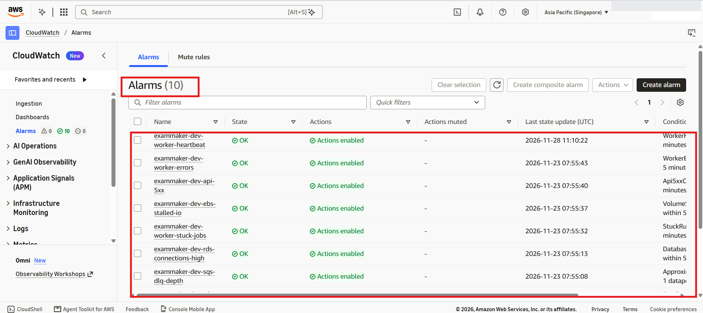

In this section, we build a proactive monitoring and alerting stack at **$0/month** (100% within AWS Free Tier): an SNS Topic (`exammaker-dev-alerts`), a 7-day CloudWatch Log Group (`/exammaker/dev/app`) with 4 Metric Filters, and exactly **10/10 Standard CloudWatch Alarms**.

---

### 1. Create SNS Topic & Email Subscription

#### Step 1: Create the `exammaker-dev-alerts` SNS Topic

1. Open **Amazon SNS** in `ap-southeast-1` → select **Topics → Create topic**.
2. Configure:
  * *Type:* `Standard`
  * *Name:* `exammaker-dev-alerts`
  * *Display name:* `ExamMakerAlert` (Max message size: `256` KiB)
3. Click **Create topic**.

#### Step 2: Subscribe Operations Team Emails

1. Inside the `exammaker-dev-alerts` topic, click **Create subscription**.
2. Select **Protocol:** `Email` and enter the engineering team email addresses (**4 email subscribers**).
3. Click **Confirm subscription** in each confirmation email so the status transitions to `Confirmed`.

---

### 2. Create 7-Day Log Group & Metric Filters

#### Step 1: Create `/exammaker/dev/app` Log Group with 7-Day Retention

1. Open **Amazon CloudWatch → Logs → Log groups → Create log group**.
2. Configure:
  * *Log group name:* `/exammaker/dev/app`
  * *Retention setting:* `1 week (7 days)` _(keeps log storage well under the 5 GB free tier cap)_
  * *Log class:* `Standard`

#### Step 2: Create 4 Metric Filters Under Namespace `ExamMaker/Dev`

Inside `/exammaker/dev/app`, open **Metric filters → Create metric filter** to publish 4 operational metrics into namespace `ExamMaker/Dev` (`Metric value = 1`, `Unit = Count`):

1. `Api5xxCount` (tracks HTTP 5xx server errors from the backend API)
2. `WorkerHeartbeat` (verifies the background AI Worker process is alive)
3. `StuckRunningJobs` (detects jobs stuck in `Running` state)
4. `WorkerErrorCount` (counts unhandled Worker exceptions during Bedrock / RDS calls)

---

### 3. Configure & Verify 10 CloudWatch Alarms

#### Complete Set of 10/10 Standard CloudWatch Alarms (`Period = 300s` — Free Tier $0)

All 10 alarms route notifications to the `exammaker-dev-alerts` SNS Topic and report **100% `OK` status**:

1. `exammaker-dev-worker-heartbeat`: `< 1` over 5 minutes
2. `exammaker-dev-worker-errors`: `>= 3` errors over 5 minutes
3. `exammaker-dev-api-5xx`: `>= 5` HTTP 5xx responses over 5 minutes
4. `exammaker-dev-ebs-stalled-io`: `> 0` stalled I/O events on the root EBS volume
5. `exammaker-dev-worker-stuck-jobs`: `> 0` stuck jobs over 5 minutes
6. `exammaker-dev-rds-connections-high`: `> 50` database connections
7. `exammaker-dev-sqs-dlq-depth`: `> 0` messages in the Dead-Letter Queue
8. `exammaker-dev-sqs-oldest-msg`: oldest message age `> 600s` (10 minutes)
9. `exammaker-dev-ec2-cpu-high`: CPU utilization `> 80%` for 10 minutes (`2 x 5m`)
10. `exammaker-dev-rds-storage-low`: free storage space `< 2 GB` (`2,147,483,648` bytes)

