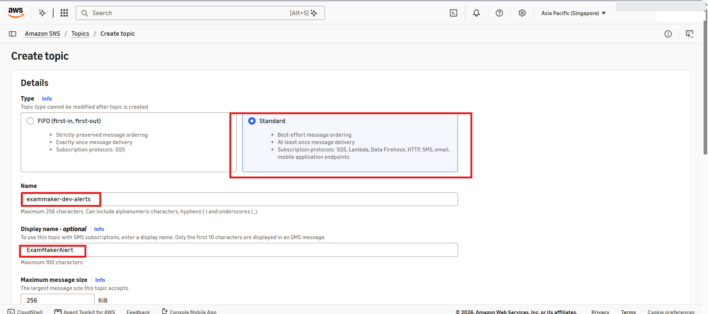
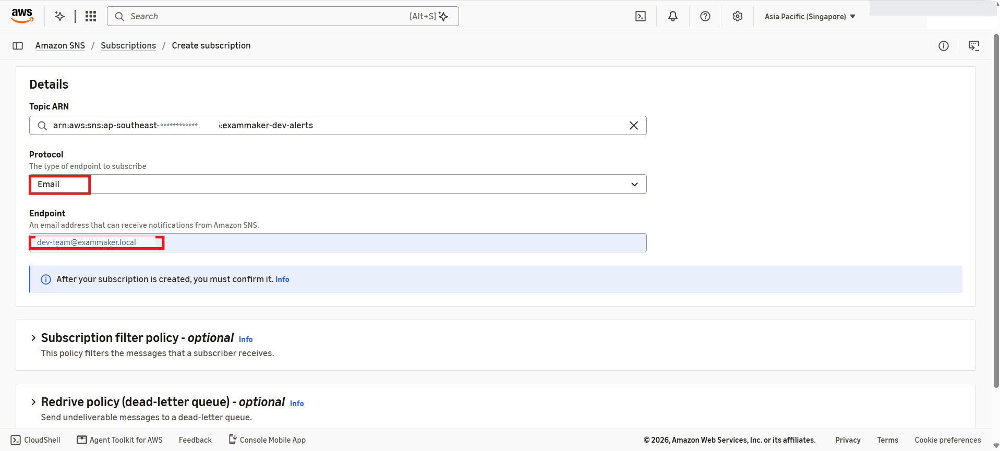
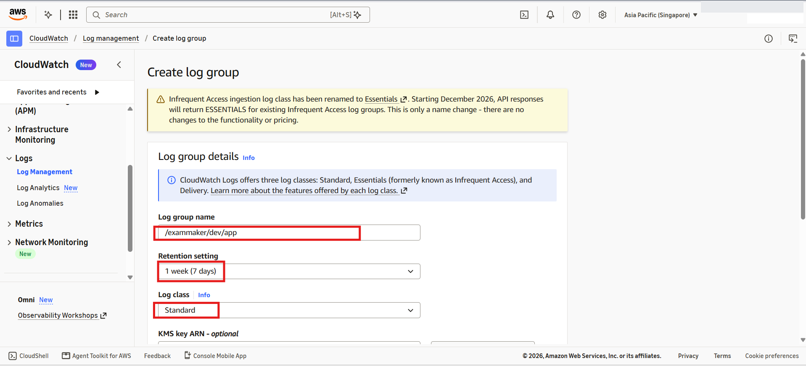
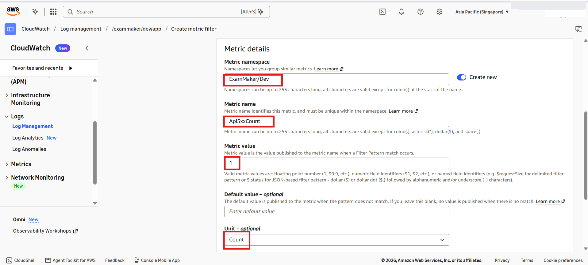
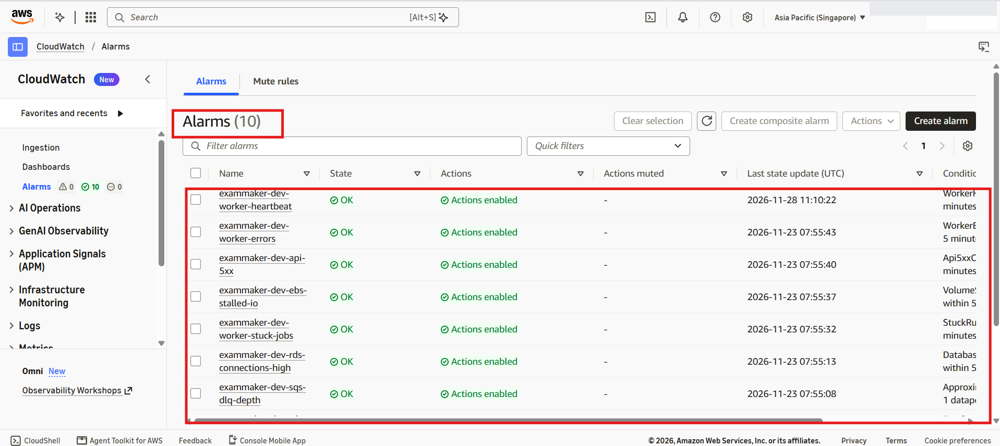

Trong phần này, chúng ta thiết lập hệ thống giám sát và cảnh báo chủ động với chi phí **$0/tháng** (nằm trọn trong hạn mức AWS Free Tier): gồm SNS Topic `exammaker-dev-alerts`, CloudWatch Log Group `/exammaker/dev/app` lưu 7 ngày kèm 4 Metric Filters, và đúng **10/10 Standard CloudWatch Alarms**.

---

### 1. Tạo SNS Topic & Email Subscription

#### Bước 1: Tạo SNS Topic `exammaker-dev-alerts`

1. Mở **Amazon SNS** tại region `ap-southeast-1` → chọn **Topics → Create topic**.
2. Cấu hình:
  * *Type:* `Standard`
  * *Name:* `exammaker-dev-alerts`
  * *Display name:* `ExamMakerAlert` (Max message size: `256` KiB)
3. Bấm **Create topic**.

#### Bước 2: Đăng ký Email Subscription cho đội kỹ thuật

1. Trong trang chi tiết topic `exammaker-dev-alerts`, chọn **Create subscription**.
2. Chọn **Protocol:** `Email` và nhập địa chỉ email của các thành viên đội vận hành (**4 email subscribers**).
3. Xác nhận link **Confirm subscription** trong hộp thư đến để chuyển trạng thái sang `Confirmed`.

---

### 2. Tạo Log Group 7 Ngày & Metric Filters

#### Bước 1: Tạo CloudWatch Log Group `/exammaker/dev/app` lưu giữ 7 ngày

1. Mở **Amazon CloudWatch → Logs → Log groups → Create log group**.
2. Cấu hình:
  * *Log group name:* `/exammaker/dev/app`
  * *Retention setting:* `1 week (7 days)` (đảm bảo dung lượng log luôn nằm dưới hạn mức 5 GB miễn phí)
  * *Log class:* `Standard`

#### Bước 2: Tạo 4 Metric Filters vào Namespace `ExamMaker/Dev`

Trong Log Group `/exammaker/dev/app`, chọn tab **Metric filters → Create metric filter** để trích xuất 4 chỉ số vận hành vào namespace `ExamMaker/Dev` (`Metric value = 1`, `Unit = Count`):
1. `Api5xxCount` (đếm lỗi HTTP 5xx từ backend API)
2. `WorkerHeartbeat` (nhịp đập xác nhận tiến trình AI Worker đang hoạt động)
3. `StuckRunningJobs` (phát hiện job bị treo ở trạng thái Running)
4. `WorkerErrorCount` (đếm ngoại lệ trong quá trình Worker gọi Bedrock / RDS)

---

### 3. Thiết lập & Kiểm tra 10 CloudWatch Alarms

#### Bộ 10/10 Standard CloudWatch Alarms (`Period = 300s` — Free Tier $0)

Tất cả 10 cảnh báo gửi thông báo trực tiếp về SNS Topic `exammaker-dev-alerts` và đều đạt trạng thái `OK` 100%:

1. `exammaker-dev-worker-heartbeat`: `< 1` trong 5 phút
2. `exammaker-dev-worker-errors`: `>= 3` lỗi trong 5 phút
3. `exammaker-dev-api-5xx`: `>= 5` lỗi HTTP 5xx trong 5 phút
4. `exammaker-dev-ebs-stalled-io`: `> 0` trên ổ EBS gốc
5. `exammaker-dev-worker-stuck-jobs`: `> 0` job treo trong 5 phút
6. `exammaker-dev-rds-connections-high`: `> 50` kết nối DB
7. `exammaker-dev-sqs-dlq-depth`: `> 0` message trong DLQ
8. `exammaker-dev-sqs-oldest-msg`: tuổi message `> 600s` (10 phút)
9. `exammaker-dev-ec2-cpu-high`: CPU `> 80%` trong 10 phút (`2 x 5m`)
10. `exammaker-dev-rds-storage-low`: dung lượng trống `< 2 GB` (`2,147,483,648` bytes)

