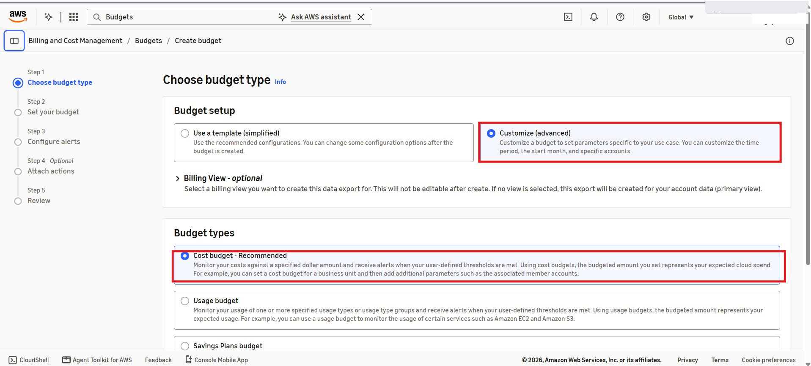
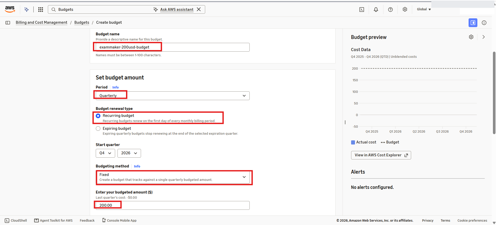
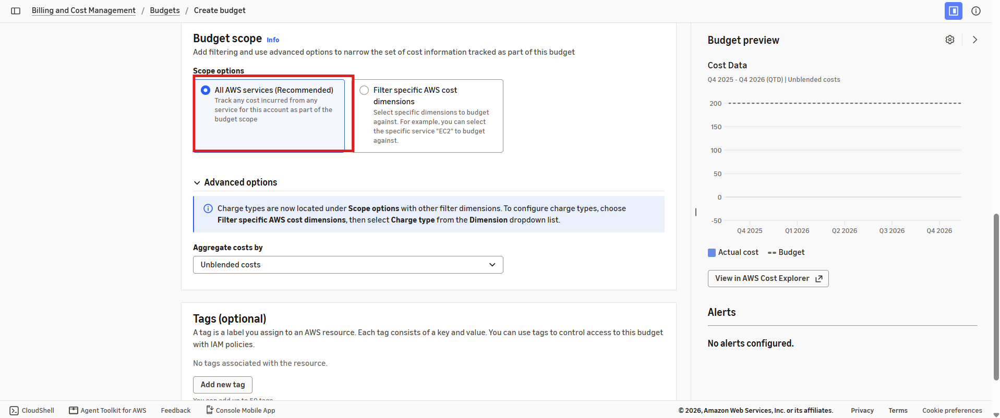

#### Step 1: Choose Advanced Cost Budget Setup

1. Open **AWS Billing and Cost Management → Budgets → Create budget**.
2. Select `Customize (advanced)` → `Cost budget - Recommended`.

#### Step 2: Set Budget Name & $200.00 Quarterly Amount

* *Budget name:* `exammaker-200usd-budget`
* *Period:* `Quarterly`
* *Budget renewal type:* `Recurring budget`
* *Budgeting method:* `Fixed`
* *Budgeted amount:* `$200.00`

#### Step 3: Scope All AWS Services & Aggregate by `Unblended costs`

* *Budget scope:* `All AWS services (Recommended)`
* *Aggregate costs by:* `Unblended costs` (measures gross consumption before AWS Credits are applied, giving accurate visibility into real burn rate).

