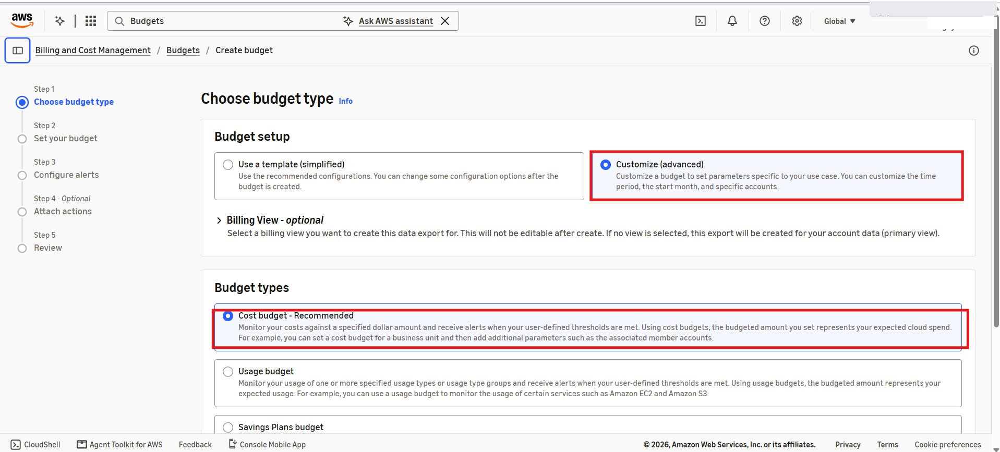
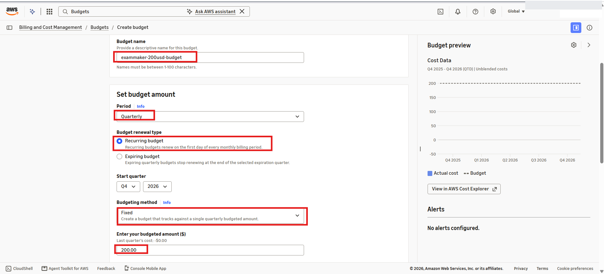
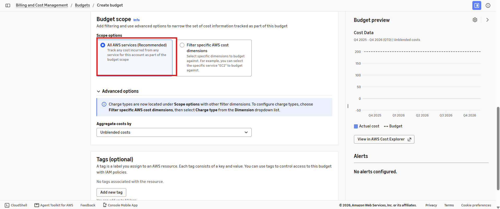

#### Bước 1: Chọn loại ngân sách Cost Budget nâng cao

1. Mở **AWS Billing and Cost Management → Budgets → Create budget**.
2. Chọn `Customize (advanced)` → `Cost budget - Recommended`.

#### Bước 2: Thiết lập tên ngân sách & Định mức $200.00/Quý

* *Budget name:* `exammaker-200usd-budget`
* *Period:* `Quarterly` (Theo quý)
* *Budget renewal type:* `Recurring budget`
* *Budgeting method:* `Fixed`
* *Budgeted amount:* `$200.00`

#### Bước 3: Phạm vi toàn bộ dịch vụ & Tổng hợp theo `Unblended costs`

* *Budget scope:* `All AWS services (Recommended)`
* *Aggregate costs by:* `Unblended costs` (đo lường trực tiếp trên chi phí gốc phát sinh trước khi trừ AWS Credit để theo dõi chính xác tốc độ tiêu thụ thực tế).

