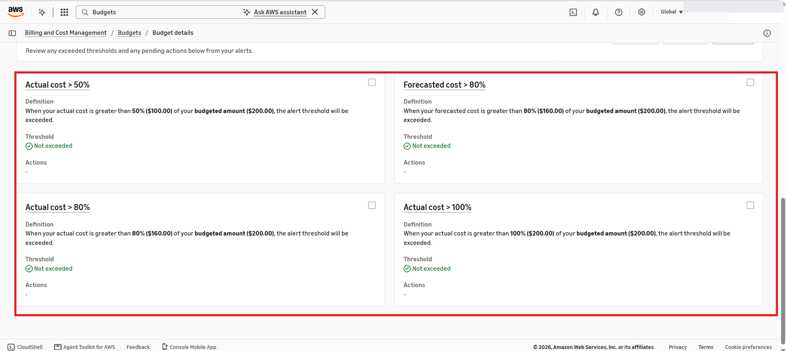

#### Configure & Verify 4 Email Alert Thresholds

Attach **4 automated email alerts** so the team receives early warnings before reaching the quarterly ceiling:

1. **Actual cost > `50%`** (`$100.00`) — `Not exceeded`
2. **Actual cost > `80%`** (`$160.00`) — `Not exceeded`
3. **Actual cost > `100%`** (`$200.00`) — `Not exceeded`
4. **Forecasted cost > `80%`** (`$160.00`) — `Not exceeded`

