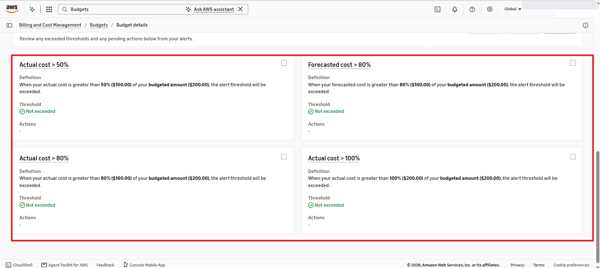

#### Thiết lập & Xác nhận 4 Ngưỡng Cảnh báo (`Alert thresholds`)

Gắn **4 ngưỡng cảnh báo tự động gửi email** cho đội vận hành để phát hiện sớm mọi dấu hiệu tăng chi phí bất thường:

1. **Actual cost > `50%`** (`$100.00`) — trạng thái `Not exceeded`
2. **Actual cost > `80%`** (`$160.00`) — trạng thái `Not exceeded`
3. **Actual cost > `100%`** (`$200.00`) — trạng thái `Not exceeded`
4. **Forecasted cost > `80%`** (`$160.00`) — trạng thái `Not exceeded`

