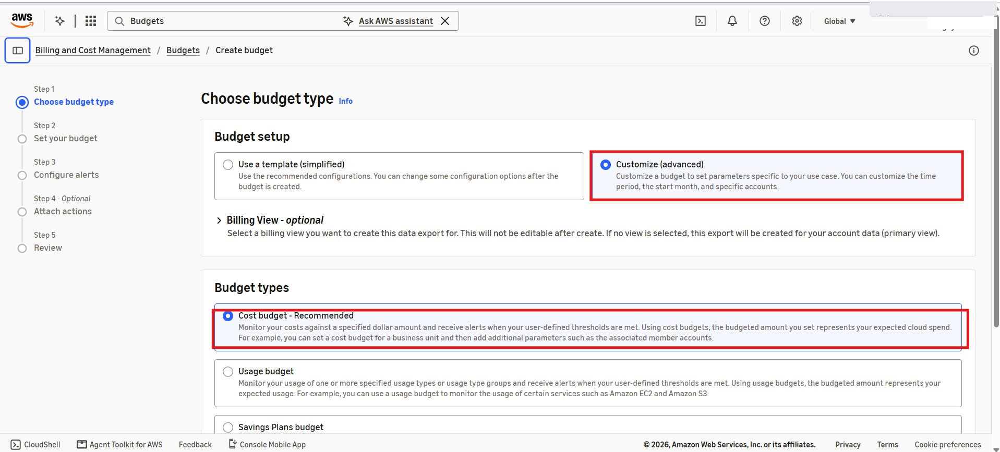
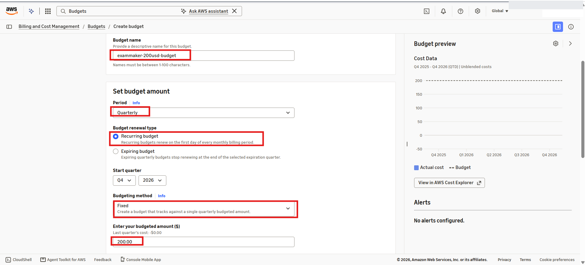
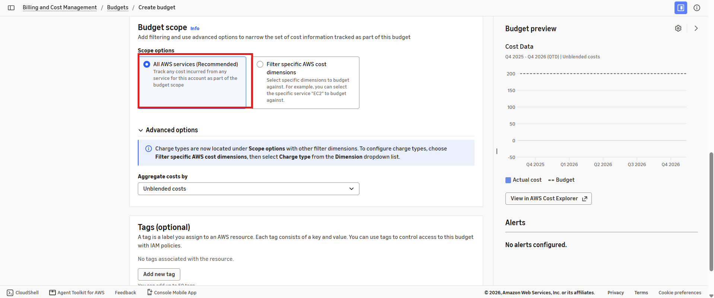
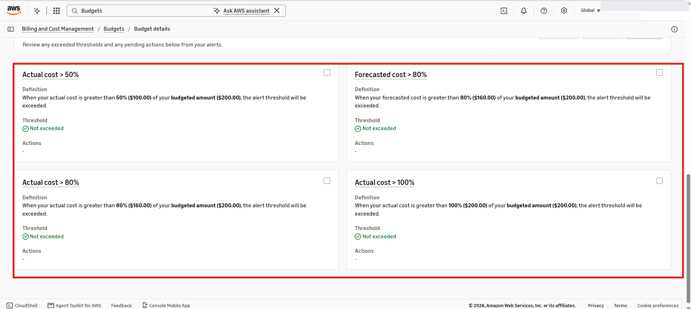

In this section, we configure an **AWS Budgets** cost budget (`exammaker-200usd-budget`) with a fixed **$200.00/Quarterly** ceiling aggregated by `Unblended costs` and **4 automated email alert thresholds** to keep total project spending strictly under control.

---

### 1. Create $200.00 Quarterly Cost Budget

#### Step 1: Choose Advanced Cost Budget Setup

1. Open **AWS Billing and Cost Management → Budgets → Create budget**.
2. Select `Customize (advanced)` → `Cost budget - Recommended`.

#### Step 2: Set Budget Name & $200.00 Quarterly Amount

* *Budget name:* `exammaker-200usd-budget`
* *Period:* `Quarterly`
* *Budget renewal type:* `Recurring budget`
* *Budgeting method:* `Fixed`
* *Budgeted amount:* `$200.00`

#### Step 3: Scope All AWS Services & Aggregate by `Unblended costs`

* *Budget scope:* `All AWS services (Recommended)`
* *Aggregate costs by:* `Unblended costs` (measures gross consumption before AWS Credits are applied, giving accurate visibility into real burn rate).

---

### 2. Configure 4 Budget Alert Thresholds

#### Configure & Verify 4 Email Alert Thresholds

Attach **4 automated email alerts** so the team receives early warnings before reaching the quarterly ceiling:

1. **Actual cost > `50%`** (`$100.00`) — `Not exceeded`
2. **Actual cost > `80%`** (`$160.00`) — `Not exceeded`
3. **Actual cost > `100%`** (`$200.00`) — `Not exceeded`
4. **Forecasted cost > `80%`** (`$160.00`) — `Not exceeded`

