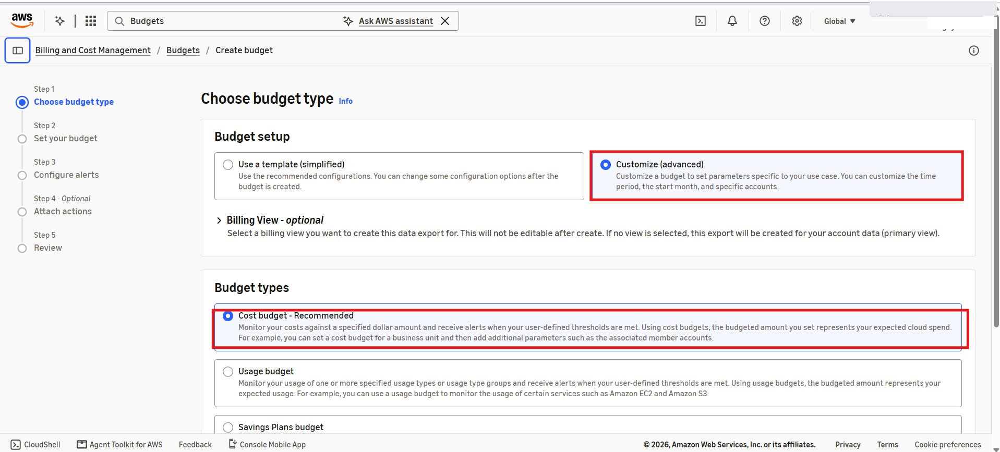
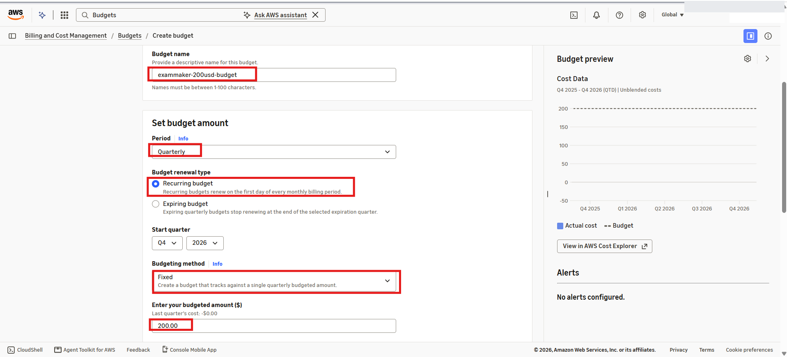
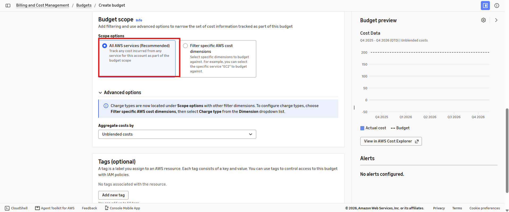
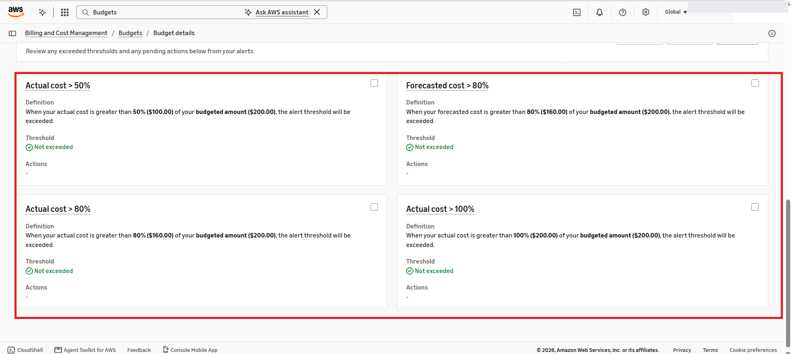

Trong phần này, chúng ta thiết lập ngân sách **AWS Budgets** (`exammaker-200usd-budget`) theo chu kỳ quý với định mức cố định **$200.00/Quý**, đo lường trên `Unblended costs` kèm **4 ngưỡng cảnh báo tự động** qua email để kiểm soát chặt chẽ chi phí toàn dự án.

---

### 1. Khởi tạo Cost Budget $200.00/Quý

#### Bước 1: Chọn loại ngân sách Cost Budget nâng cao

1. Mở **AWS Billing and Cost Management → Budgets → Create budget**.
2. Chọn `Customize (advanced)` → `Cost budget - Recommended`.

#### Bước 2: Thiết lập tên ngân sách & Định mức $200.00/Quý

* *Budget name:* `exammaker-200usd-budget`
* *Period:* `Quarterly` (Theo quý)
* *Budget renewal type:* `Recurring budget`
* *Budgeting method:* `Fixed`
* *Budgeted amount:* `$200.00`

#### Bước 3: Phạm vi toàn bộ dịch vụ & Tổng hợp theo `Unblended costs`

* *Budget scope:* `All AWS services (Recommended)`
* *Aggregate costs by:* `Unblended costs` (đo lường trực tiếp trên chi phí gốc phát sinh trước khi trừ AWS Credit để theo dõi chính xác tốc độ tiêu thụ thực tế).

---

### 2. Cấu hình 4 Ngưỡng Cảnh báo Ngân sách

#### Thiết lập & Xác nhận 4 Ngưỡng Cảnh báo (`Alert thresholds`)

Gắn **4 ngưỡng cảnh báo tự động gửi email** cho đội vận hành để phát hiện sớm mọi dấu hiệu tăng chi phí bất thường:

1. **Actual cost > `50%`** (`$100.00`) — trạng thái `Not exceeded`
2. **Actual cost > `80%`** (`$160.00`) — trạng thái `Not exceeded`
3. **Actual cost > `100%`** (`$200.00`) — trạng thái `Not exceeded`
4. **Forecasted cost > `80%`** (`$160.00`) — trạng thái `Not exceeded`

