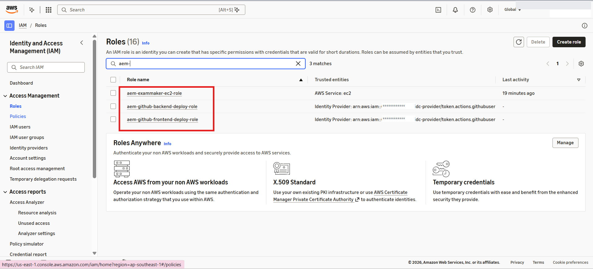

#### Configure 3 Keyless IAM Roles (`aem-*` — 3 matches)

Open **AWS IAM → Roles** and filter by prefix `aem-` to verify all **3 project IAM Roles**:

1. `aem-exammaker-ec2-role` *(Trusted entity: `AWS Service: ec2`)*:
   - Attaches `AmazonSSMManagedInstanceCore` for SSH-free administration via **SSM Session Manager** (port 22 remains closed).
   - Scoped inline Least Privilege policies granting access strictly to Amazon SQS (`exammaker-dev-ai-jobs`), 2 Amazon Bedrock models (`Claude Haiku 4.5` & `Claude Sonnet 4.6`), Cognito, read-only SSM Parameter Store under `/exammaker/dev/*`, and S3 Artifact Bucket downloads.
2. `aem-github-backend-deploy-role` *(Trusted entity: `OIDC token.actions.githubusercontent.com`)*:
   - Trust Policy locked to the `main` branch of the GitHub repository to upload backend artifacts to S3 and trigger deployments via **SSM Run Command**.
3. `aem-github-frontend-deploy-role` *(Trusted entity: `OIDC token.actions.githubusercontent.com`)*:
   - Trust Policy locked to the `main` branch to sync the Next.js Static Export to the Frontend S3 Bucket and trigger CloudFront invalidations.

