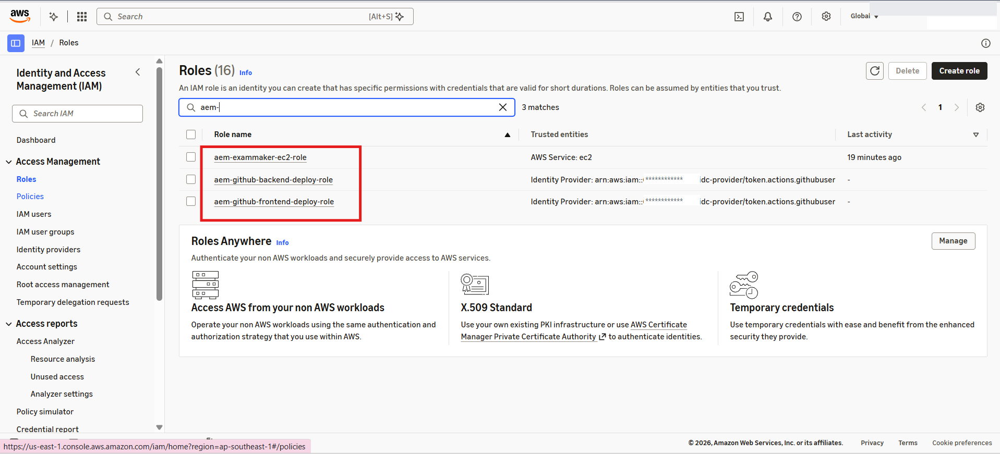

#### Cấu hình 3 IAM Roles (`aem-*` — 3 matches) không dùng Access Key dài hạn

Mở **AWS IAM → Roles** và lọc theo tiền tố `aem-` để kiểm tra đầy đủ **3 IAM Roles** của dự án:

1. `aem-exammaker-ec2-role` *(Trusted entity: `AWS Service: ec2`)*:
   - Gắn policy quản trị `AmazonSSMManagedInstanceCore` để truy cập vận hành máy chủ qua **SSM Session Manager** mà không cần mở cổng 22 SSH.
   - Các inline policies giới hạn quyền tối thiểu (Least Privilege): gọi Amazon SQS (`exammaker-dev-ai-jobs`), gọi 2 model Amazon Bedrock (`Claude Haiku 4.5` & `Claude Sonnet 4.6`), xác thực Cognito, chỉ đọc SSM Parameter Store dưới nhánh `/exammaker/dev/*` và tải gói release từ S3 Artifact Bucket.
2. `aem-github-backend-deploy-role` *(Trusted entity: `OIDC token.actions.githubusercontent.com`)*:
   - Khóa chặt điều kiện Trust Policy vào nhánh `main` của GitHub repo để đẩy gói build lên S3 và kích hoạt triển khai tự động qua **SSM Run Command**.
3. `aem-github-frontend-deploy-role` *(Trusted entity: `OIDC token.actions.githubusercontent.com`)*:
   - Khóa chặt điều kiện Trust Policy vào nhánh `main` để đồng bộ Next.js Static Export lên S3 Frontend Bucket và tạo CloudFront Invalidation.

