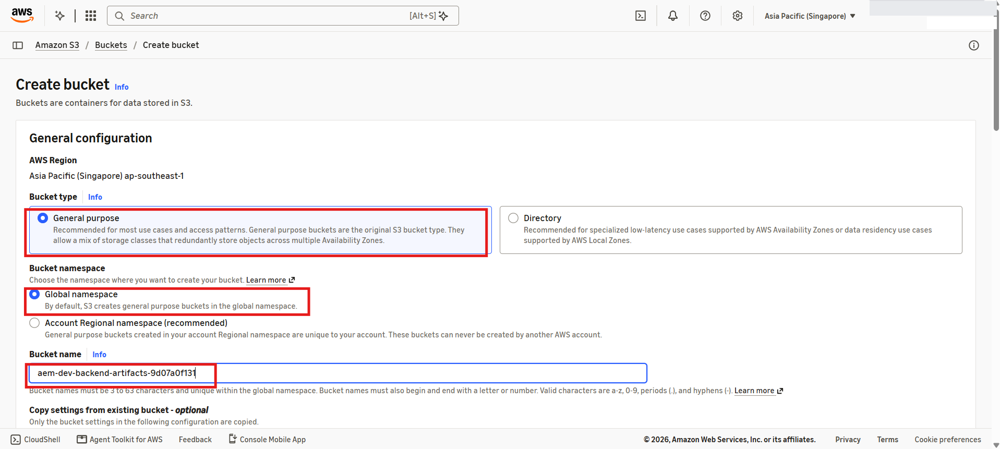
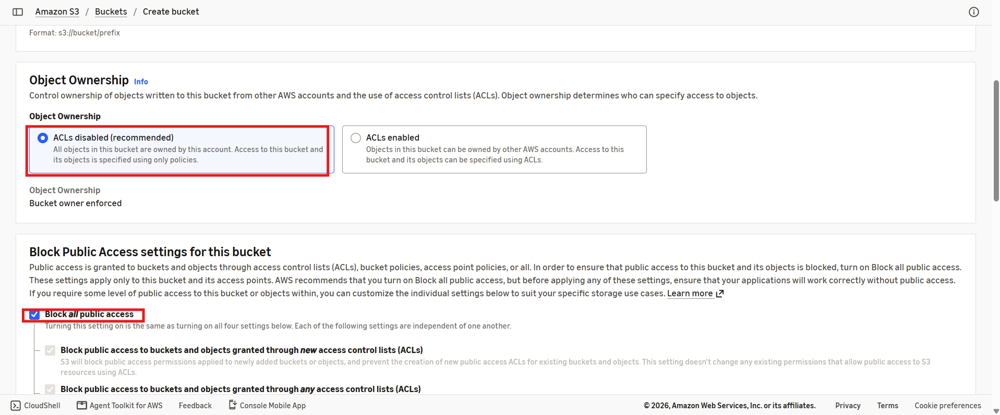

#### Bước 1: Khởi tạo S3 Bucket em-dev-backend-artifacts-9d07a0f131 tại Vùng p-southeast-1 (Hình 19)

1. Mở **Amazon S3 Console** tại vùng **Asia Pacific (Singapore) ap-southeast-1** → chọn **Buckets** → bấm **Create bucket**.
2. Tại mục **General configuration**:
   - **Bucket type:** Tích chọn **General purpose**.
   - **Bucket namespace:** Tích chọn **Global namespace**.
   - **Bucket name:** Điền **em-dev-backend-artifacts-9d07a0f131**.

---

#### Bước 2: Cấu hình ACLs disabled & Chặn Truy cập Công khai Block all public access (Hình 19.2)

1. Kéo xuống mục **Object Ownership**:
   - Tích chọn **ACLs disabled (recommended)** (Bucket owner enforced).
2. Tại mục **Block Public Access settings for this bucket**:
   - Giữ tích chọn **Block all public access** (chặn hoàn toàn mọi truy cập công khai từ Internet).
3. Giữ mã hóa mặc định **SSE-S3 (AES-256)** (), bấm **Create bucket** và gắn Lifecycle rule expire-old-artifacts tự động xóa gói build cũ sau **30 ngày**.

