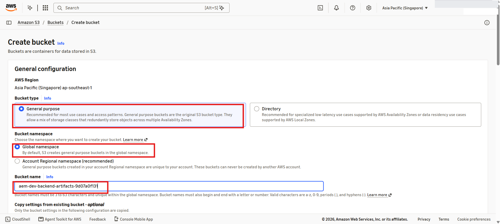
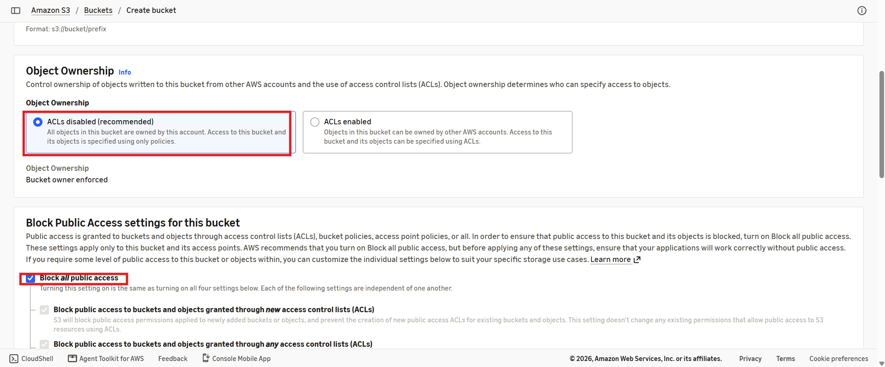

#### Bước 1: Tạo S3 Bucket lưu trữ gói release backend

1. Mở **Amazon S3 → Create bucket**.
2. Cấu hình thông tin định danh:
  * *AWS Region:* `Asia Pacific (Singapore) ap-southeast-1`
  * *Bucket type:* `General purpose` · **Namespace:** `Global namespace`
  * *Bucket name:* `aem-dev-backend-artifacts-9d07a0f131`

#### Bước 2: Bật Block All Public Access, SSE-S3 & Lifecycle 30 Ngày

* *Object Ownership:* `ACLs disabled (recommended)` (`Bucket owner enforced`).
* *Block Public Access:* bật `Block all public access = Enabled` 100%.
* *Default encryption:* `SSE-S3 (AES-256)` (**$0**).
* *Lifecycle rule:* tự động xóa các gói artifact bản build cũ sau `30 days` để tránh tích lũy dung lượng lưu trữ không cần thiết.

