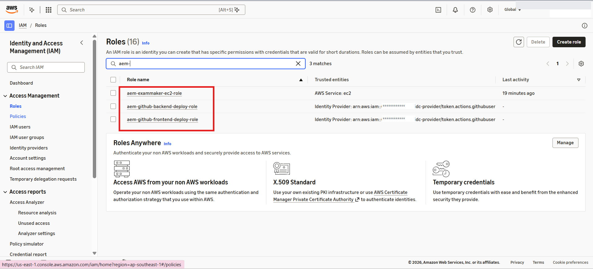
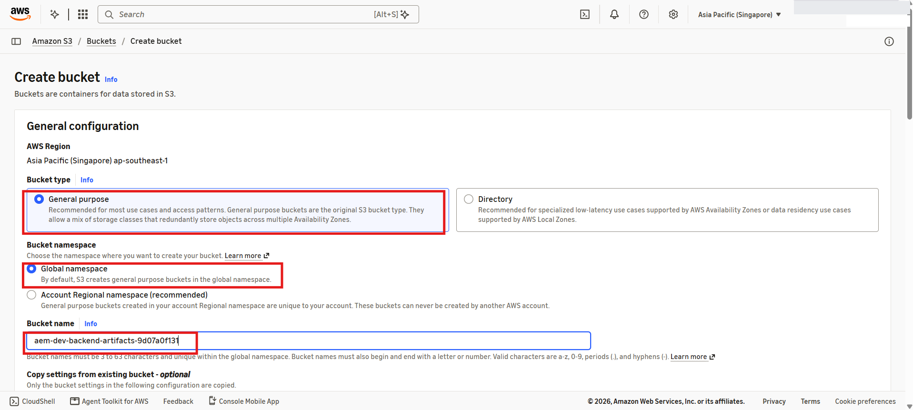
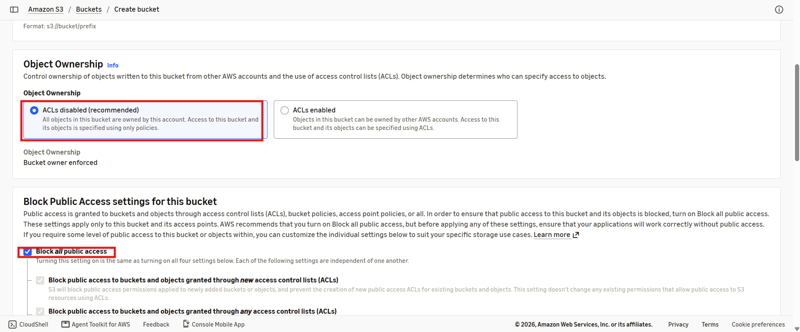

In this section, we establish a keyless, SSH-free security foundation for operations and CI/CD: **3 IAM Roles** (`aem-*`) enforcing **Least Privilege / GitHub OIDC** and a **private S3 Artifact Bucket** (`aem-dev-backend-artifacts-9d07a0f131`) with a 30-day automatic expiration lifecycle rule.

---

### 1. Configure 3 IAM Roles & Permissions Policies

#### Configure 3 Keyless IAM Roles (`aem-*` — 3 matches)

Open **AWS IAM → Roles** and filter by prefix `aem-` to verify all **3 project IAM Roles**:

1. `aem-exammaker-ec2-role` *(Trusted entity: `AWS Service: ec2`)*:
   - Attaches `AmazonSSMManagedInstanceCore` for SSH-free administration via **SSM Session Manager** (port 22 remains closed).
   - Scoped inline Least Privilege policies granting access strictly to Amazon SQS (`exammaker-dev-ai-jobs`), 2 Amazon Bedrock models (`Claude Haiku 4.5` & `Claude Sonnet 4.6`), Cognito, read-only SSM Parameter Store under `/exammaker/dev/*`, and S3 Artifact Bucket downloads.
2. `aem-github-backend-deploy-role` *(Trusted entity: `OIDC token.actions.githubusercontent.com`)*:
   - Trust Policy locked to the `main` branch of the GitHub repository to upload backend artifacts to S3 and trigger deployments via **SSM Run Command**.
3. `aem-github-frontend-deploy-role` *(Trusted entity: `OIDC token.actions.githubusercontent.com`)*:
   - Trust Policy locked to the `main` branch to sync the Next.js Static Export to the Frontend S3 Bucket and trigger CloudFront invalidations.

---

### 2. Create Private S3 Artifact Bucket

#### Step 1: Create the Backend Release Artifact S3 Bucket

1. Open **Amazon S3 → Create bucket**.
2. Configure the bucket identity:
  * *AWS Region:* `Asia Pacific (Singapore) ap-southeast-1`
  * *Bucket type:* `General purpose` · **Namespace:** `Global namespace`
  * *Bucket name:* `aem-dev-backend-artifacts-9d07a0f131`

#### Step 2: Enforce Block All Public Access, SSE-S3 & 30-Day Lifecycle

* *Object Ownership:* `ACLs disabled (recommended)` (`Bucket owner enforced`).
* *Block Public Access:* enforce `Block all public access = Enabled` (100% private).
* *Default encryption:* `SSE-S3 (AES-256)` (**$0**).
* *Lifecycle rule:* automatically expire old build artifacts after `30 days` to avoid unnecessary storage accumulation.

