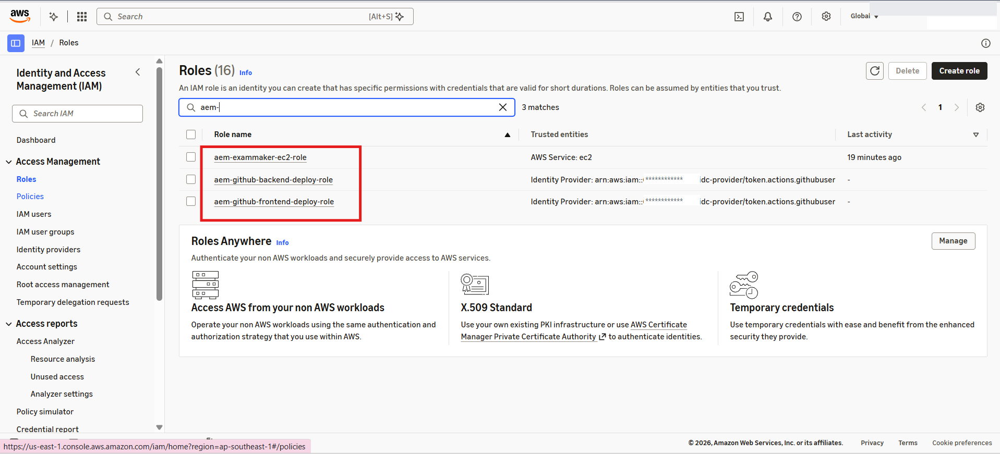
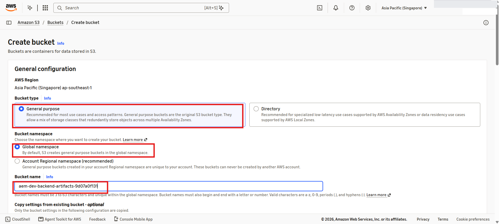
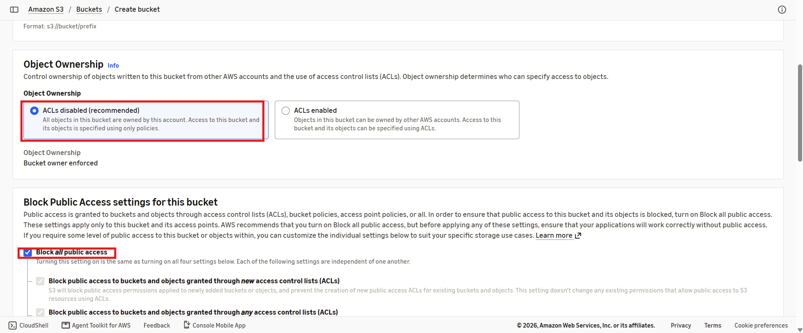

Trong phần này, chúng ta thiết lập nền tảng bảo mật không dùng cổng SSH (port 22) và không dùng Access Key dài hạn cho vận hành & CI/CD: gồm **3 IAM Roles** (`aem-*`) theo chuẩn **Least Privilege / GitHub OIDC** và **S3 Artifact Bucket riêng tư** (`aem-dev-backend-artifacts-9d07a0f131`) kèm Lifecycle 30 ngày.

---

### 1. Thiết lập 3 IAM Roles & Permissions Policies

#### Cấu hình 3 IAM Roles (`aem-*` — 3 matches) không dùng Access Key dài hạn

Mở **AWS IAM → Roles** và lọc theo tiền tố `aem-` để kiểm tra đầy đủ **3 IAM Roles** của dự án:

1. `aem-exammaker-ec2-role` *(Trusted entity: `AWS Service: ec2`)*:
   - Gắn policy quản trị `AmazonSSMManagedInstanceCore` để truy cập vận hành máy chủ qua **SSM Session Manager** mà không cần mở cổng 22 SSH.
   - Các inline policies giới hạn quyền tối thiểu (Least Privilege): gọi Amazon SQS (`exammaker-dev-ai-jobs`), gọi 2 model Amazon Bedrock (`Claude Haiku 4.5` & `Claude Sonnet 4.6`), xác thực Cognito, chỉ đọc SSM Parameter Store dưới nhánh `/exammaker/dev/*` và tải gói release từ S3 Artifact Bucket.
2. `aem-github-backend-deploy-role` *(Trusted entity: `OIDC token.actions.githubusercontent.com`)*:
   - Khóa chặt điều kiện Trust Policy vào nhánh `main` của GitHub repo để đẩy gói build lên S3 và kích hoạt triển khai tự động qua **SSM Run Command**.
3. `aem-github-frontend-deploy-role` *(Trusted entity: `OIDC token.actions.githubusercontent.com`)*:
   - Khóa chặt điều kiện Trust Policy vào nhánh `main` để đồng bộ Next.js Static Export lên S3 Frontend Bucket và tạo CloudFront Invalidation.

---

### 2. Khởi tạo S3 Artifact Bucket Riêng tư

#### Bước 1: Tạo S3 Bucket lưu trữ gói release backend

1. Mở **Amazon S3 → Create bucket**.
2. Cấu hình thông tin định danh:
  * *AWS Region:* `Asia Pacific (Singapore) ap-southeast-1`
  * *Bucket type:* `General purpose` · **Namespace:** `Global namespace`
  * *Bucket name:* `aem-dev-backend-artifacts-9d07a0f131`

#### Bước 2: Bật Block All Public Access, SSE-S3 & Lifecycle 30 Ngày

* *Object Ownership:* `ACLs disabled (recommended)` (`Bucket owner enforced`).
* *Block Public Access:* bật `Block all public access = Enabled` 100%.
* *Default encryption:* `SSE-S3 (AES-256)` (**$0**).
* *Lifecycle rule:* tự động xóa các gói artifact bản build cũ sau `30 days` để tránh tích lũy dung lượng lưu trữ không cần thiết.

